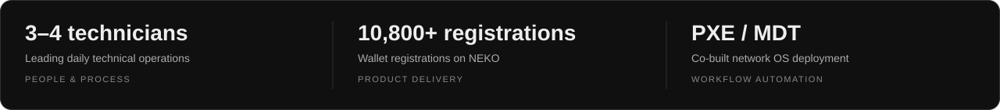
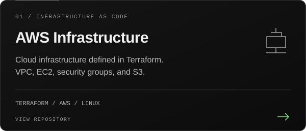
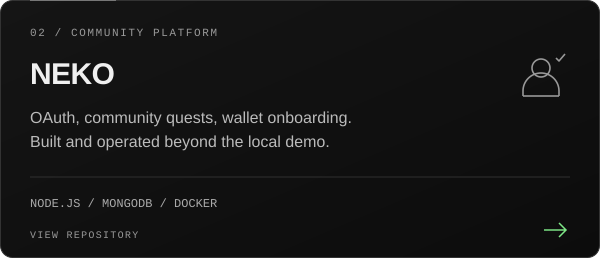
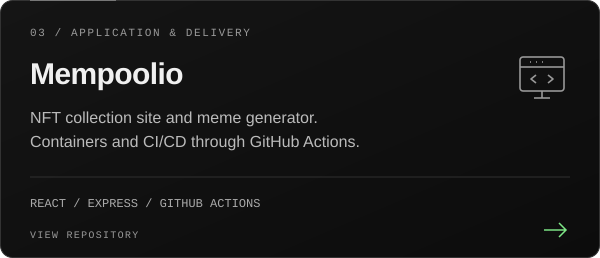
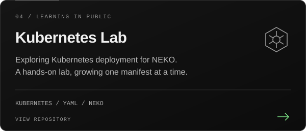

  

  <a href="https://github.com/maltego-net?tab=repositories">Explore my work</a>
  &nbsp;&nbsp; / &nbsp;&nbsp;
  <a href="https://www.linkedin.com/in/rostickzlud/">LinkedIn</a>
  &nbsp;&nbsp; / &nbsp;&nbsp;
  <a href="mailto:rostyslav@zhludko.dev">Get in touch</a>

I build and operate the systems behind everyday work: deployment infrastructure, Linux servers, web applications, and tools that remove repetitive tasks.

Based in **Hamburg**, I lead a technical operations team at **Notebook-Pro**. I co-built our network OS deployment platform using Proxmox and Windows Server with PXE/MDT, helping move device imaging from hands-on USB installs to unattended network deployment.

  

## Selected work

<table>
  <tr>
    <td width="50%" valign="top"></td>
    <td width="50%" valign="top"></td>
  </tr>
  <tr>
    <td width="50%" valign="top"></td>
    <td width="50%" valign="top"></td>
  </tr>
</table>

**Two connected builds:** Mempoolio is the application; `terraform-aws-mempoolio` defines its AWS infrastructure. NEKO is the community platform; `k8s-neko` is my Kubernetes learning project around it.

## What I work with

| Area | Tools and technologies |
| :--- | :--- |
| **Systems & infrastructure** | Linux · Proxmox VE · Windows Server · Active Directory · PXE/MDT · Nginx |
| **Cloud & delivery** | AWS · Terraform · Docker · Docker Compose · GitHub Actions · GHCR |
| **Automation & integration** | Python · Bash · TypeScript · Node.js · REST APIs · MCP |
| **Applications & data** | React · Next.js · Fastify · PostgreSQL · SQLite · MongoDB · Redis |

## Currently building

**Kityz** — a self-hosted platform for coordinating AI coding agents on my own machines. I'm working on a TypeScript/Fastify orchestrator, WebSocket runners, and MCP integration, with isolated execution and human approval for consequential actions. **In progress.**

I also run a **multi-user Linux server** with Docker services, Nginx routing, SSH key access, firewall rules, and separate user environments. My interests connect at the point where software has to run reliably on real hardware.

<strong>A little more about my background</strong>

 

- **Technical operations:** daily work planning, technician onboarding, hardware diagnostics, and process automation.
- **Product development:** built the website for an early-stage rental startup and delivered a commercial Next.js / Sanity website for a client.
- **Security foundations:** university studies in cybersecurity, network design, Linux administration, and practical virtual-machine labs.
- **Languages:** English, German, Ukrainian, and Russian.

 

  

