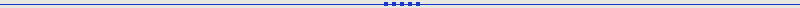
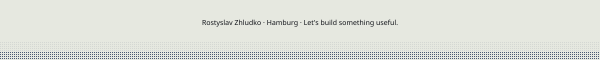

  <picture><source media="(prefers-color-scheme: dark)" srcset="assets/hero-dark.svg"></picture>

<h1 align="center">Rostyslav Zhludko</h1>

IT Operations, Infrastructure and Automation. Hamburg, Germany.

  <a href="https://github.com/maltego-net?tab=repositories">Explore my work</a>
  &nbsp;&nbsp; / &nbsp;&nbsp;
  <a href="https://www.linkedin.com/in/rostickzlud/">LinkedIn</a>
  &nbsp;&nbsp; / &nbsp;&nbsp;
  <a href="mailto:rostyslav@zhludko.dev">Email</a>

I build and operate the systems behind everyday work: deployment infrastructure, Linux servers, web applications, and tools that remove repetitive tasks.

Based in **Hamburg**, I lead a technical operations team at **Notebook-Pro**. I co-built our network OS deployment platform using Proxmox and Windows Server with PXE/MDT, helping move device imaging from hands-on USB installs to unattended network deployment.

<picture><source media="(prefers-color-scheme: dark)" srcset="assets/divider-dark.svg"></picture>

## Selected work

<table>
  <tr>
    <td width="50%" valign="top"><a href="https://github.com/maltego-net/terraform-aws-mempoolio"><picture><source media="(prefers-color-scheme: dark)" srcset="assets/project-infrastructure-dark.svg"></picture></a> <a href="https://github.com/maltego-net/terraform-aws-mempoolio"><strong>AWS Infrastructure</strong></a> Terraform configuration for VPC, EC2, security groups and S3.</td>
    <td width="50%" valign="top"><a href="https://github.com/maltego-net/neko"><picture><source media="(prefers-color-scheme: dark)" srcset="assets/project-neko-dark.svg"></picture></a> <a href="https://github.com/maltego-net/neko"><strong>NEKO</strong></a> NFT community platform with Twitter OAuth, quests and wallet registration.</td>
  </tr>
  <tr>
    <td width="50%" valign="top"><a href="https://github.com/maltego-net/mempoolio"><picture><source media="(prefers-color-scheme: dark)" srcset="assets/project-mempoolio-dark.svg"></picture></a> <a href="https://github.com/maltego-net/mempoolio"><strong>Mempoolio</strong></a> React and Express application with a meme generator, Docker and GitHub Actions.</td>
    <td width="50%" valign="top"><a href="https://github.com/maltego-net/k8s-neko"><picture><source media="(prefers-color-scheme: dark)" srcset="assets/project-kubernetes-dark.svg"></picture></a> <a href="https://github.com/maltego-net/k8s-neko"><strong>Kubernetes Lab</strong></a> Learning project exploring Kubernetes deployment for NEKO.</td>
  </tr>
</table>

## What I work with

| Area | Tools and technologies |
| :--- | :--- |
| **Systems & infrastructure** | Linux · Proxmox VE · Windows Server · Active Directory · PXE/MDT · Nginx |
| **Cloud & delivery** | AWS · Terraform · Docker · Docker Compose · GitHub Actions · GHCR |
| **Automation & integration** | Python · Bash · TypeScript · Node.js · REST APIs · MCP |
| **Applications & data** | React · Next.js · Fastify · PostgreSQL · SQLite · MongoDB · Redis |

## Currently building

**Kityz** is a self-hosted platform for coordinating AI coding agents on my own machines. It is in development.

<strong>A little more about my background</strong>

 

- **Technical operations:** daily work planning, technician onboarding, hardware diagnostics, and process automation.
- **Product development:** built the website for an early-stage rental startup and delivered a commercial Next.js / Sanity website for a client.
- **Security foundations:** university studies in cybersecurity, network design, Linux administration, and practical virtual-machine labs.
- **Languages:** English, German, Ukrainian, and Russian.

## Contacts

- [LinkedIn](https://www.linkedin.com/in/rostickzlud/)
- [Email](mailto:rostyslav@zhludko.dev)

  <picture><source media="(prefers-color-scheme: dark)" srcset="assets/footer-dark.svg"></picture>

