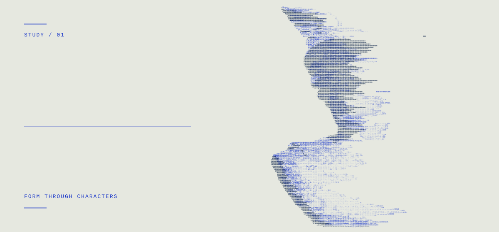

# Rostyslav Zhludko

**Infrastructure / Systems / Automation** Hamburg, Germany

[Selected work](#selected-work) · [LinkedIn](https://www.linkedin.com/in/rostickzlud/) · [Get in touch](mailto:rostyslav@zhludko.dev)

<picture>
  <source media="(prefers-reduced-motion: reduce) and (max-width: 600px) and (prefers-color-scheme: dark)" srcset="assets/hermes-dark-mobile.svg" />
  <source media="(prefers-reduced-motion: reduce) and (max-width: 600px)" srcset="assets/hermes-light-mobile.svg" />
  <source media="(prefers-reduced-motion: reduce) and (prefers-color-scheme: dark)" srcset="assets/hermes-dark.svg" />
  <source media="(prefers-reduced-motion: reduce)" srcset="assets/hermes-light.svg" />
  <source media="(max-width: 600px) and (prefers-color-scheme: dark)" srcset="assets/hermes-dark-mobile.gif" />
  <source media="(max-width: 600px)" srcset="assets/hermes-light-mobile.gif" />
  <source media="(prefers-color-scheme: dark)" srcset="assets/hermes-dark.gif" />
  <source srcset="assets/hermes-light.gif" />
  
</picture>

## About

I build and operate deployment infrastructure, Linux servers, web applications, and tools that remove repetitive work. My interests meet where software has to run reliably on real hardware.

## Experience

I lead **3–4 technicians** at **Notebook-Pro** across daily planning, onboarding, hardware diagnostics, and process automation. I co-built our network OS deployment platform with **Proxmox, Windows Server, and PXE/MDT**, moving device imaging from hands-on USB installs to unattended network deployment.

I also built a website for an early-stage rental startup and delivered a commercial **Next.js / Sanity** website for a client.

## Selected work

<table width="100%">
  <tbody>
    <tr><td width="100%"><strong>01 · Infrastructure — <a href="https://github.com/maltego-net/terraform-aws-mempoolio">AWS infrastructure</a></strong> Terraform for AWS VPC, EC2, security groups, and S3; infrastructure for Mempoolio.</td></tr>
    <tr><td width="100%"><strong>02 · Community — <a href="https://github.com/maltego-net/neko">NEKO</a></strong> NFT platform with Twitter OAuth, quests, and wallet registration. <strong>10,800+ wallet registrations.</strong></td></tr>
    <tr><td width="100%"><strong>03 · Application — <a href="https://github.com/maltego-net/mempoolio">Mempoolio</a></strong> React and Express app with a meme generator, Docker, and GitHub Actions.</td></tr>
    <tr><td width="100%"><strong>04 · Learning lab — <a href="https://github.com/maltego-net/k8s-neko">Kubernetes lab</a></strong> A learning project exploring Kubernetes deployment for NEKO.</td></tr>
  </tbody>
</table>

## Toolkit

**Systems & infrastructure** Linux · Proxmox VE · Windows Server · Active Directory · PXE/MDT · Nginx

**Cloud & delivery** AWS · Terraform · Docker · Docker Compose · GitHub Actions · GHCR · Kubernetes (learning)

**Automation & integration** Python · Bash · TypeScript · Node.js · REST APIs · MCP

**Applications & data** React · Next.js · Fastify · PostgreSQL · SQLite · MongoDB · Redis

## Currently building

**Kityz — in progress.** A self-hosted platform for coordinating AI coding agents on my own machines. I'm working on a TypeScript/Fastify orchestrator, WebSocket runners, and MCP integration, with isolated execution and human approval for consequential actions.

I also run a **multi-user Linux server** with Docker services, Nginx routing, SSH key access, firewall rules, and separate user environments.

Background & languages

University studies in cybersecurity, network design, Linux administration, and practical virtual-machine labs.

English · German · Ukrainian · Russian

---

[Explore my repositories](https://github.com/maltego-net?tab=repositories) · [LinkedIn](https://www.linkedin.com/in/rostickzlud/) · [Email](mailto:rostyslav@zhludko.dev)
